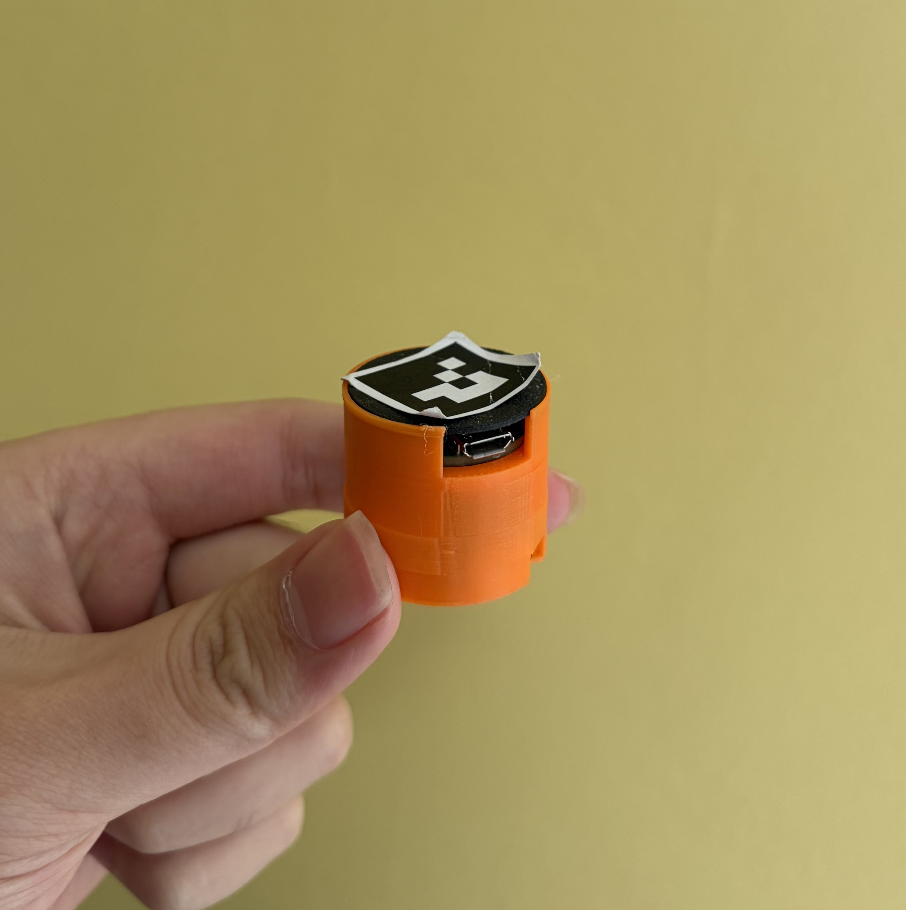
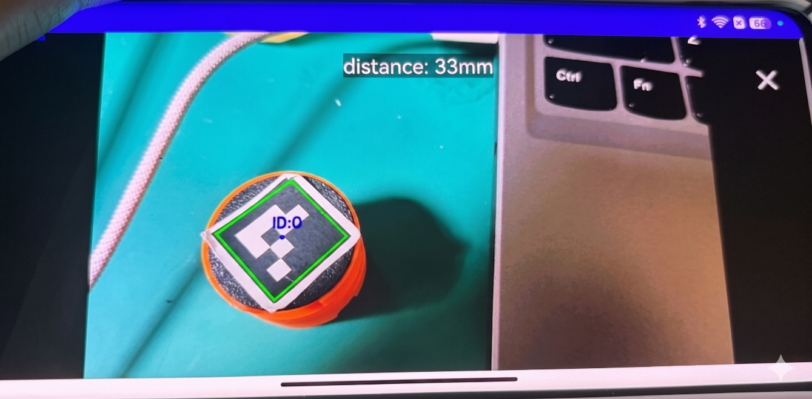
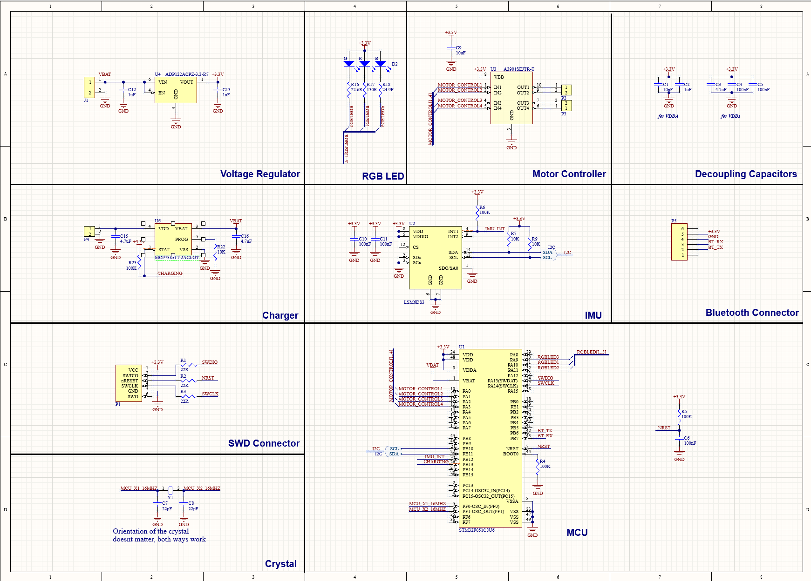
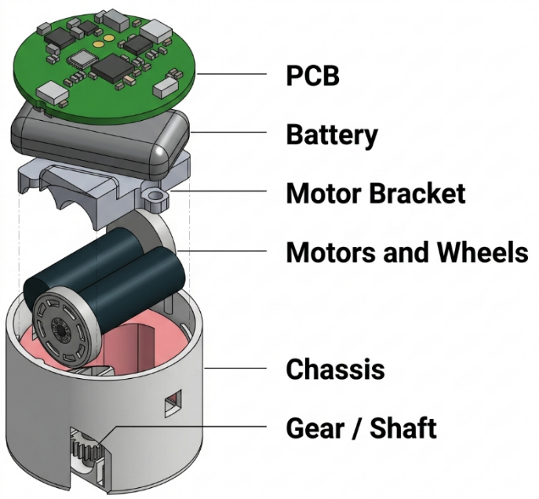
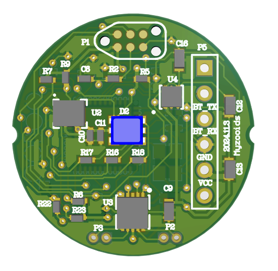

# Myzooids — project notes

By Yuxuan Chen · haruyuki

## Team planning & coordination

As team lead, I broke the project into hardware, mechanical, software and algorithm tasks, coordinated their progress and worked through the interfaces between them. My role included hands-on development as well as bringing the different contributions into an integrated prototype.

## Control circuits & PCB

I designed the robot control schematics, produced PCBs and assembled the components. I worked through the board’s connection to firmware and the mechanical structure as part of integrating the electronics into the robot.

## Mechanical prototyping

I used 3D modelling and printing to iterate the robot structure alongside the electronics. This work connected the physical assembly with board placement, control hardware and the wider prototype.

## Firmware & Android application

I developed MCU firmware in C and completed an Android control application. These formed the embedded and mobile sides of the control system, connecting the hardware interfaces with the user’s control surface.

## Vision & system integration

I integrated the hardware interfaces with computer-vision and path-planning modules, then carried out whole-system functional checks. My contribution focused on joining the modules and validating how they worked together.

## Source & documentation

I organised the source code, design explanations and complete project documentation for publication on GitHub. Recording the build and integration work was part of the project delivery.

## Engineering images

These images document the assembled prototype and its design.

### Completed prototype

### Live computer vision

### Circuit schematic

### Exploded mechanical assembly

### PCB layout

